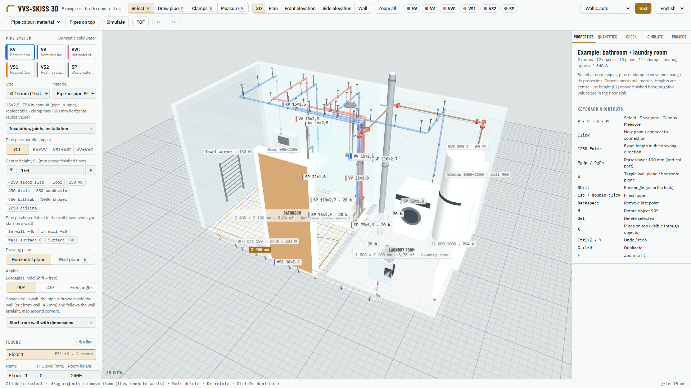
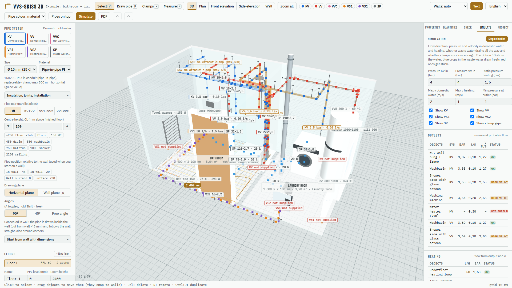
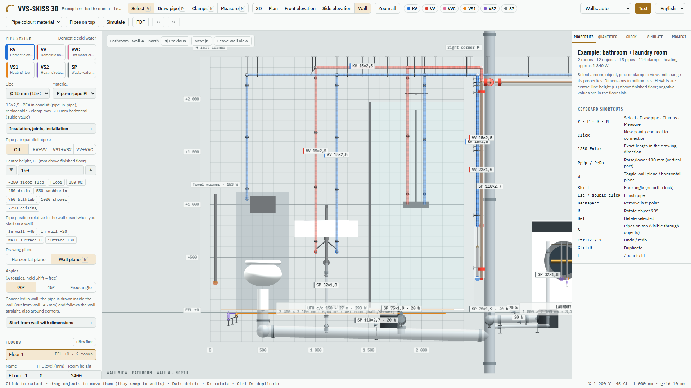
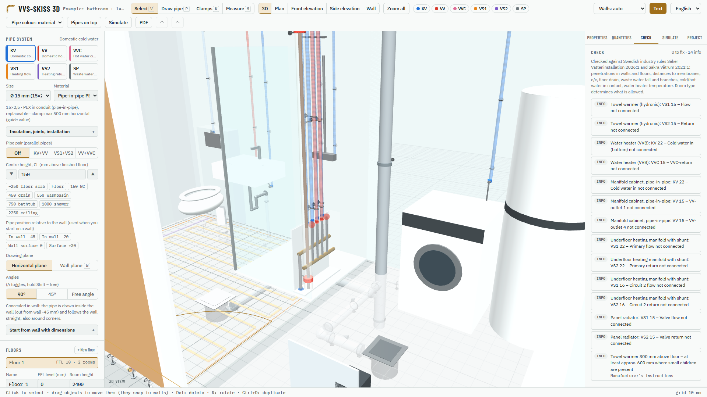
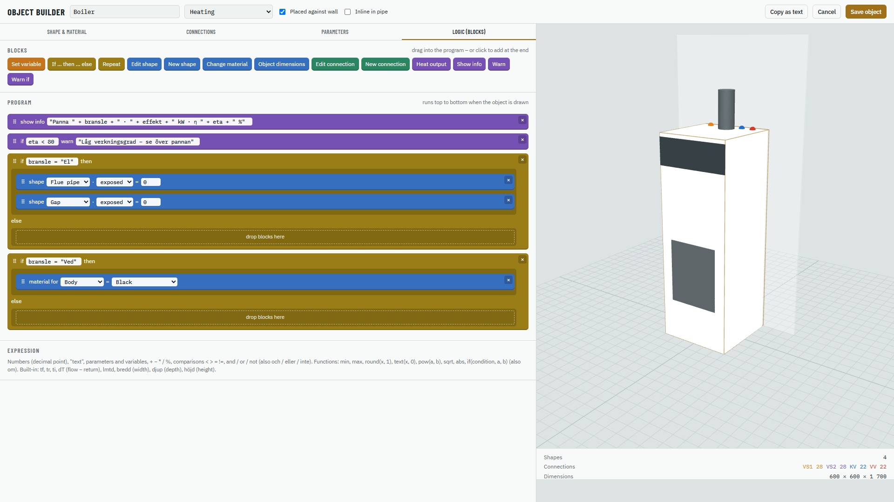

# VVS-skiss 3D

A free Windows app for sketching plumbing and heating installations in 3D – bathrooms, laundry rooms, kitchens and boiler rooms at real scale. Available in **English** and **Swedish** (switch language in the top bar).

**[Download the latest version](https://github.com/antonleigue/VVS-skiss-3D/releases/latest)** – get `VVS-skiss-3D.exe` and run it. No installation needed, and the app works offline.

## Features

- **Rooms and floors** in millimetres – snap rooms together, draw your own walls, add doors and windows.
- **Fixtures and furniture** – WC, washbasin, bathtub, shower, radiators, underfloor heating, water heater, washing machine, utility sink, manifold cabinet and more. Build **custom objects** (e.g. boilers) from templates with your own connections, materials and drag-and-drop block logic.
- **Pipes** for domestic cold water (KV), domestic hot water (VV), hot water circulation (VVC), heating flow/return (VS1/VS2) and waste water (SP) with a visible 1–3 % fall.
  - Draw wall to wall at 90°, 45° or any angle; snap to walls, the floor, connections and other pipes.
  - Pipe pairs (KV+VV, VS1+VS2) side by side at any c/c.
  - Pipe-in-pipe concealed inside the wall, or exposed pipes on the surface.
  - Pipes show their material: copper, chrome-plated, stainless, steel, PEX, multilayer, PP, PVC, PE and cast iron – with coloured bands for the system.
  - Single and double pipe clamps, automatic or manual.
- **Wall view** – focus on a wall and draw straight onto it.
- **Rule check** against the Swedish industry rules *Säker Vatten* (2026:1) and common practice, e.g. distances to waterproofing, penetrations, pipe spacing and radiator placement.
- **Simulation** of flow direction, pressure (bar), clamping and waste water fall.
- **Bill of quantities** for pipes, fittings and clamps.
- **PDF drawings** from several angles (plan, elevations, wall views, 3D) and project files you can save and reopen.

| | |
|---|---|
|  |  |
|  |  |

## Requirements

- Windows 10 or 11 (64-bit).
- Microsoft Edge WebView2 Runtime – already included in Windows 11 and most Windows 10 installations. If it is missing, the app tells you.

The `.exe` is not code-signed, so Windows SmartScreen may warn the first time. Choose *More info → Run anyway*. A signed version is on its way to the Microsoft Store.

## Privacy

The app collects no personal data. See the [privacy policy](PRIVACY.md).

## Note

VVS-skiss 3D is a sketching tool. The checks are guidance only and do not replace current regulations, Säker Vatten authorisation or the manufacturer's instructions. The system abbreviations (KV, VV, VVC, VS1, VS2, SP) follow Swedish practice.
